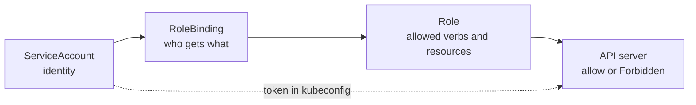

<div align="center">

# 🔐 RBAC Personas & Break-Glass

**Least-privilege access on a local Kubernetes cluster, proven by an automated permission test suite.**


*CLO835 – Portable Technologies in Cloud · Semester Project 11*

**Student ID:** `hoaminu` · **Namespace:** `rbac-hoaminu`

</div>

---

## 📖 Overview

Three identities, each with only the permissions its job needs, and one documented emergency admin path.
Everything runs on a two-node [kind](https://kind.sigs.k8s.io/) cluster, defined as raw YAML and driven by
kubectl, and a single script rebuilds it from nothing.

| Persona | ServiceAccount | Job |
|---|---|---|
| 🛠️ **Deployer** | `deployer-hoaminu` | Manage the app: deployments, pods, services, configmaps |
| 👁️ **Read-only auditor** | `readonly-hoaminu` | Look but never touch. Cannot read Secrets |
| 🤖 **CI pusher** | `ci-hoaminu` | Roll a new image and verify it. Nothing more |
| 🚨 **Break-glass** | kind admin kubeconfig | Emergency repair only. Logged, short-lived |

## 🧭 How it fits together



A request is allowed only if a **RoleBinding** connects the caller's **ServiceAccount** to a **Role** that lists the
verb and resource. Everything else is denied by default.

## 🔑 Permission matrix

| Resource | Deployer | Read-only | CI |
|---|:---:|:---:|:---:|
| pods, services, configmaps | full | get / list / watch | none |
| deployments | full | get / list / watch | **get, patch** |
| replicasets | full | none | none |
| events | none | get / list / watch | none |
| **secrets** | none | none | none |
| RBAC objects (roles, bindings) | none | none | none |
| other namespaces | none | none | none |

"full" means get, list, watch, create, update, patch and delete. Roles and bindings are namespaced, so none of
them grant anything outside `rbac-hoaminu`.

## 🚀 Quick start

Requires Docker, kind, kubectl and jq.

```bash
./bootstrap.sh              # cluster + RBAC + workload + kubeconfigs + test suite (about 90 seconds)
./tests/rbac-test.sh        # 28 checks, PASS/FAIL per line, exit 1 on any mismatch
```

Act as a persona:

```bash
source ./env.sh
kubectl --kubeconfig kubeconfigs/readonly.kubeconfig get pods                    # works
kubectl --kubeconfig kubeconfigs/readonly.kubeconfig get secret db-creds-$SID    # Forbidden
```

Open the emergency admin path (logged to `break-glass.log`):

```bash
./break-glass.sh            # interactive admin shell, type exit to leave
```

If persona tokens expire (they last 48 hours): `./bootstrap.sh kubeconfigs`

## 🧪 The test suite

`tests/rbac-test.sh` runs `kubectl auth can-i` for every line of `tests/expected.txt`, using each persona's own
kubeconfig, and compares the answer with the expected one. It mixes expected-yes and expected-no checks, so it
proves what each persona *cannot* do as well as what it can. Anything other than a clear yes or no (for example an
expired token) counts as a failure.

## 🩺 Fault drills

`drills/` simulates the four ways RBAC can break, so diagnosis can be practised from persona-side symptoms only:

| Fault | Break |
|---|---|
| a | A RoleBinding is deleted |
| b | A Role's verbs are edited |
| c | A binding's subject points at the wrong ServiceAccount |
| d | A binding is recreated in the wrong namespace |

Repair for every fault: `kubectl apply -f manifests/rbac/`, then rerun the test suite.

## 📁 Repository layout

```text
.
├── bootstrap.sh              # single entry point; SID and Docker Hub user are defined here only
├── env.sh                    # reads the config from bootstrap.sh for the other scripts
├── kind-config.yaml          # 1 control-plane + 1 worker
├── break-glass.sh            # logged cluster-admin access
├── runbook.md                # exact, tested operating procedures
├── manifests/
│   ├── rbac/                 # namespace, ServiceAccounts, Roles, RoleBindings
│   └── workload/             # nginx Deployment, Service, ConfigMap, Secret
├── tests/
│   ├── rbac-test.sh          # permission test runner
│   └── expected.txt          # the answer key
├── drills/                   # fault injection for practice
├── evidence/                 # transcript of a clean bootstrap and green test run
├── teardown.sh               # delete the cluster
└── make-evidence.sh          # rebuild from scratch and record the transcript
```

Manifests exist as `*.yaml.tpl` templates (placeholder `__SID__`) and the rendered `*.yaml` that kubectl applies.
Changing `SID` in `bootstrap.sh` and rerunning renames every object.

## 🛡️ Design notes

- **Least privilege:** each Role lists exactly what the persona needs. Nothing is granted that is not named.
- **No cluster-admin for personas:** a leaked token, especially the CI one, would otherwise control the whole cluster.
- **Namespaced Roles only:** a binding grants rights in its own namespace and nowhere else.
- **Tokens are never committed:** persona kubeconfigs are generated at bootstrap and excluded by `.gitignore`.
- **Reproducible:** one script from a clean host, with the permission suite as the final step.

See [`runbook.md`](runbook.md) for the full procedures.
